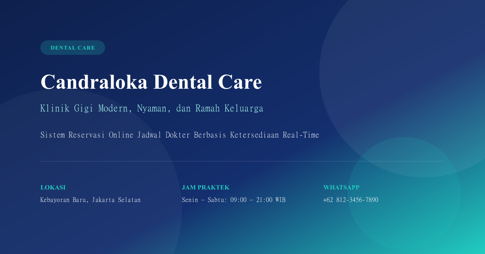
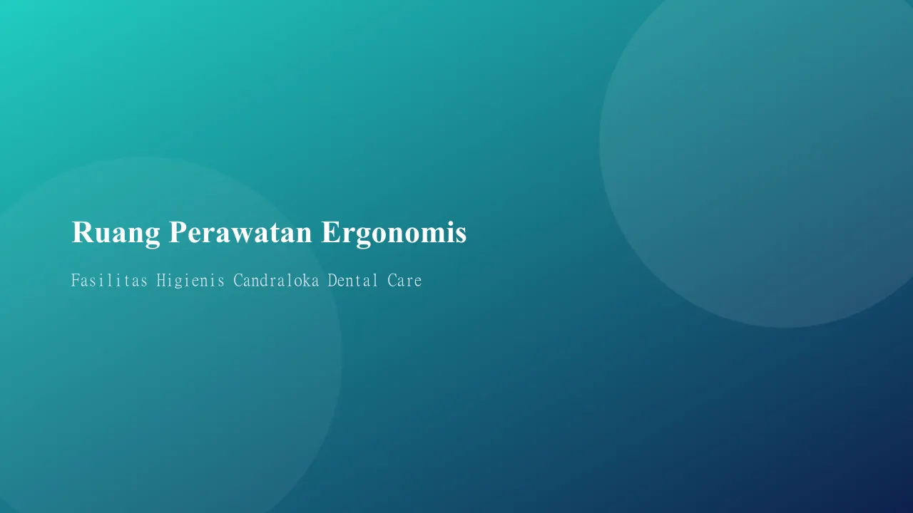
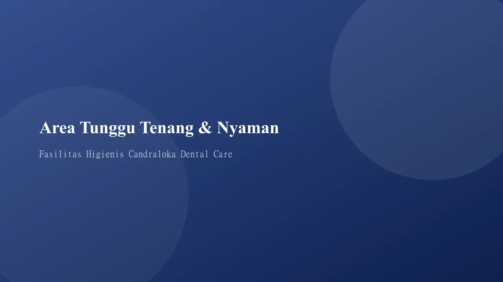
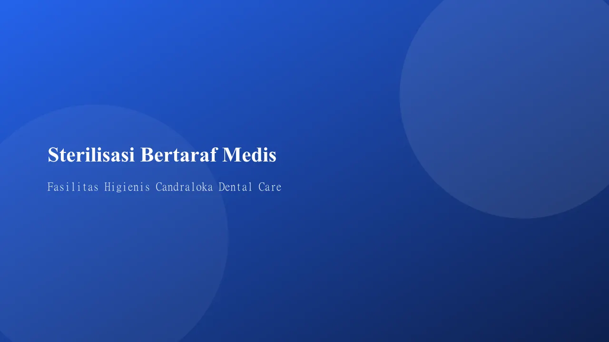
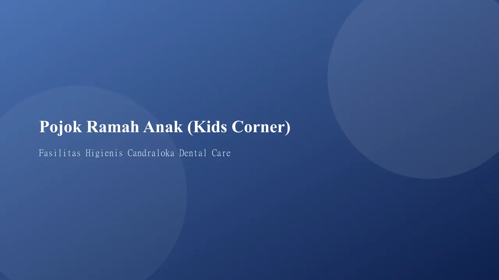

# Candraloka Dental Care

<p align="center">
  
</p>

<p align="center">
  <strong>Website Klinik Gigi Modern dengan Sistem Reservasi Online Berbasis Ketersediaan Real-Time</strong>
</p>

<p align="center">
  <a href="https://vuejs.org/"></a>
  <a href="https://vitejs.dev/"></a>
  <a href="https://tailwindcss.com/"></a>
  <a href="https://vitest.dev/"></a>
  <a href="https://zod.dev/"></a>
</p>

---

## 📌 Tentang Proyek

**Candraloka Dental Care** adalah aplikasi web klinik gigi modern yang dirancang untuk menghadirkan pengalaman pengguna (UX) yang transparan, menenangkan, dan efisien. Website ini berfokus pada desain medis profesional dengan palet warna klinis elegan (*Deep Navy* `#0e204d` & *Dental Sapphire Blue* `#1e60d5`).

Fitur keunggulan utama proyek ini adalah **Sistem Reservasi Online Berbasis Ketersediaan Waktu Nyata (Real-Time Availability)**:
- 🕒 **Kalkulasi Slot Otomatis**: Menghitung ketersediaan jadwal dokter per sesi (pagi, siang, sore) secara dinamis dari jam operasional mingguan.
- 📅 **Deteksi Cuti & Antrean**: Menghitung kuota tersisa dengan memperhitungkan tanggal cuti dokter, slot yang sudah terisi (*booked slots*), dan reservasi aktif di peramban.
- 🧭 **Smart Doctor Assignment**: Mendukung penetapan dokter otomatis berbasis rotasi beban layanan (*"Dokter Mana Saja yang Tersedia"*).
- 🏷️ **Kode Reservasi Unik**: Membuat kode booking resmi (`CDC-YYMMDD-XXXX`) dan ringkasan janji temu otomatis terintegrasi ke tautan pesan WhatsApp (`wa.me`).

> ℹ️ **Catatan Portofolio:** Seluruh profil dokter, testimoni, alamat, dan nomor kontak pada proyek ini bersifat rekaan untuk kebutuhan demonstrasi rekayasa antarmuka (*frontend engineering*). Tidak ada transaksi finansial nyata yang diproses.

---

## 📸 Tampilan & Fasilitas Klinik

<table align="center" width="100%">
  <tr>
    <td width="50%" align="center">
      <br />
      <b>Ruang Perawatan Ergonomis</b><br />
      <sub>Dental chair modern & pencahayaan ramah mata</sub>
    </td>
    <td width="50%" align="center">
      <br />
      <b>Area Tunggu Tenang & Nyaman</b><br />
      <sub>Suasana sejuk, alunan musik lembut, dan ruang santai</sub>
    </td>
  </tr>
  <tr>
    <td width="50%" align="center">
      <br />
      <b>Sterilisasi Bertaraf Medis</b><br />
      <sub>Autoclave medis canggih & pouch instrumen steril</sub>
    </td>
    <td width="50%" align="center">
      <br />
      <b>Pojok Ramah Anak (Kids Corner)</b><br />
      <sub>Area bermain ceria, aman, dan higienis untuk si kecil</sub>
    </td>
  </tr>
</table>

---

## ✨ Fitur & Halaman Utama

1. **Beranda (`/`):**
   - Hero banner dinamis dengan *Dual CTA* terarah (*Buat Reservasi* & *Lihat Jadwal*).
   - Live badge status operasional klinik hari ini (Buka / Tutup dengan indikator jam WIB).
   - Animasi *counter* angka pencapaian klinik (tahun melayani, pasien tersenyum, dokter spesialis).
   - Ringkasan katalog layanan unggulan, profil dokter spesialis pilihan, dan ulasan pasien.

2. **Tentang Kami (`/tentang`):**
   - Cerita awal mula klinik, visi, dan misi pelayanan kesehatan gigi.
   - Nilai layanan klinik: Pelayanan Empatis, Standar Higienis, Teknologi Terkini, dan Ramah Keluarga.
   - Galeri fasilitas modern dengan gambar WebP multi-resolusi responsif.
   - Alur kunjungan pasien terpandu (5 langkah dari kedatangan hingga edukasi pasca tindakan).

3. **Katalog & Detail Layanan (`/layanan`, `/layanan/:slug`):**
   - 8 Layanan komprehensif (Scaling, Penambalan, Pencabutan, Bleaching, Behel, Perawatan Saluran Akar, Veneer, Gigi Anak).
   - Filter cepat kategori dan pencarian nama perawatan instan.
   - Halaman detail terstruktur: indikasi perawatan, langkah prosedur bertahap, persiapan sebelum kunjungan, estimasi durasi, dan dokter pelaksana.

4. **Direktori Dokter (`/dokter`, `/dokter/:slug`):**
   - Pencarian dokter berdasarkan nama atau spesialisasi klinis.
   - Profil dokter detail: riwayat pendidikan, minat klinis, bahasa yang dikuasai, dan jadwal praktek mingguan.
   - Indikator sesi praktek aktif hari ini dan pengumuman jadwal cuti dokter.

5. **Jadwal Praktek Terpadu (`/jadwal`):**
   - Kalender jadwal mingguan dokter x hari (Senin – Minggu) yang rapi tanpa perlu geser/scroll horizontal.
   - Penanda denyut dinamis *"Sedang Praktek"* untuk dokter yang sedang bertugas di jam aktif klinik.
   - Sinkronisasi filter otomatis ke query URL (`?dokter=...&hari=...`).

6. **Sistem Reservasi Online 4 Langkah (`/reservasi`):**
   - **Langkah 1 (Layanan):** Pilihan jenis perawatan gigi beserta estimasi durasi waktu.
   - **Langkah 2 (Dokter):** Opsi dokter spesifik atau penugasan otomatis (*smart assignment*).
   - **Langkah 3 (Jadwal):** Strip navigator 14 hari dengan status ketersediaan visual dan pembagian slot waktu (Pagi, Siang, Sore).
   - **Langkah 4 (Data Pasien):** Formulir tervalidasi Zod (nama, WhatsApp, email opsional, status pasien baru/lama, batas catatan, dan proteksi honeypot).
   - **Konfirmasi Janji Temu:** Penerbitan kode resmi `CDC-YYMMDD-XXXX`, tombol integrasi WhatsApp, dan opsi salin jadwal ke kalender.

7. **Kontak & Lokasi Klinik (`/kontak`):**
   - *Live Embed Google Maps* interaktif langsung terpusat ke lokasi klinik.
   - Jadwal jam buka lengkap 7 hari per minggu dengan label status buka/tutup hari ini.
   - Akses cepat tombol panggil telepon dan tautan percakapan WhatsApp.

8. **Halaman Error 404 Kustom (`/:pathMatch(.*)*`):**
   - Tampilan ramah pengguna dengan tombol kembali ke Beranda atau Reservasi.

---

## 🛠️ Tech Stack & Arsitektur

| Layer | Teknologi | Peran & Keunggulan |
|---|---|---|
| **Core Framework** | [Vue 3](https://vuejs.org/) (Composition API) | Performa reaktif tinggi dengan `<script setup>` |
| **Build Tool** | [Vite](https://vitejs.dev/) | HMR ultra-cepat dan bundling produksi teroptimasi |
| **Routing** | [Vue Router 4](https://router.vuejs.org/) | Lazy-loaded routes & penanganan state URL dinamis |
| **Styling** | [Tailwind CSS](https://tailwindcss.com/) | Desain sistem berbasis token tanpa warna tosca (*Navy & Dental Blue*) |
| **Validasi Form** | [Zod](https://zod.dev/) + VeeValidate | Validasi skema tipe-aman dengan pesan kesalahan ramah pengguna |
| **Metadata & SEO** | `@unhead/vue` | Manajemen dinamis title, meta description, Open Graph, dan Twitter Cards |
| **Pengolahan Gambar** | [`sharp`](https://sharp.pixelplumbing.com/) | Pipeline konversi gambar WebP otomatis 3 ukuran (1280, 768, 480 px) |
| **Tipografi** | Plus Jakarta Sans | Self-hosted WOFF2 font lokal (`font-display: swap`), zero third-party delay |
| **Testing** | [Vitest](https://vitest.dev/) + Vue Test Utils | 93 unit tests otomatis untuk fungsi murni, ketersediaan slot, dan komponen UI |
| **Penyimpanan Data** | Local JSON + Browser Storage | Reservasi disimpan di `localStorage`, draft sesi di `sessionStorage` |

---

## ♿ Standar Kualitas UX & Aksesibilitas (WCAG AA)

- **Mobile First Ergonomics**: Area sentuh tombol minimal 44×44 px, ukuran font isian form minimal 16 px (`text-base`) untuk mencegah auto-zoom pada peramban mobile (iOS Safari).
- **Resiliensi Data Sesi**: Formulir reservasi otomatis tersimpan ke `sessionStorage` saat berpindah langkah atau me-refresh halaman sehingga data pasien tidak hilang.
- **Pencegahan Cumulative Layout Shift (CLS)**: Seluruh gambar konten disajikan dengan rasio aspek terkunci melalui komponen `ResponsiveImage`.
- **Aksesibilitas Penuh**: Kontras warna memenuhi rasio WCAG AA, navigasi tombol panah keyboard (`ArrowLeft`/`ArrowRight`) pada strip tanggal kalender, dan atribut ARIA semantik.

---

## 🚀 Panduan Menjalankan Proyek

### Prasyarat
- **Node.js**: versi 20.0.0 atau lebih tinggi
- **npm**: versi 9.0.0 atau lebih tinggi

### 1. Clone & Instalasi Dependensi
```bash
# Clone repositori
git clone https://github.com/ganapurba007/candraloka-dental.git
cd candraloka-dental

# Pasang dependensi
npm install
```

### 2. Menjalankan Server Pengembangan
```bash
npm run dev
```
Aplikasi akan aktif di `http://localhost:5173`.

### 3. Menjalankan Rangkaian Pengujian
```bash
# Menjalankan 93 unit test otomatis
npm test
```

### 4. Validasi Format Gambar & Build Produksi
```bash
# Validasi kepatuhan format & anggaran gambar WebP
npm run check:images

# Build bundel produksi teroptimasi
npm run build

# Pratinjau hasil build produksi
npm run preview
```

---

## 📁 Struktur Direktori

```text
candraloka-dental/
├── context/               # Dokumentasi spesifikasi (PRD.md, rules.md, SCHEMA.md, CHANGELOG.md)
├── public/
│   ├── fonts/             # Self-hosted Plus Jakarta Sans (.woff2)
│   ├── images/            # Aset WebP teroptimasi (1280, 768, 480 px)
│   ├── icon.jpg           # Identitas logo klinik
│   └── og-image.png       # Open Graph social preview (1200x630 px)
├── scripts/
│   ├── check-images.mjs   # Validator ukuran & kepatuhan anggaran gambar
│   └── optimize-images.mjs# Pipeline konversi WebP otomatis via sharp
├── src/
│   ├── assets/            # CSS global & konfigurasi tema
│   ├── components/
│   │   ├── layout/        # Navbar, Footer, TopBar, FloatingWhatsapp, ScrollToTop
│   │   ├── ui/            # Button, Card, Badge, Accordion, Toast, StepIndicator, ResponsiveImage
│   │   ├── sections/      # Komponen seksi Beranda, Tentang, dan Lokasi
│   │   ├── doctor/        # Komponen kartu & badge dokter
│   │   └── service/       # Komponen kartu & filter layanan
│   ├── data/              # Sumber data JSON (clinic, services, doctors, home, testimonials)
│   ├── lib/               # Fungsi logika murni (time, schedule, availability, format, reservation, schemas)
│   ├── pages/             # Home, About, Services, ServiceDetail, Doctors, DoctorDetail, Schedule, Booking, Contact, NotFound
│   ├── router/            # Konfigurasi Vue Router (scrollBehavior & lazy loading)
│   ├── App.vue
│   └── main.js
├── vercel.json            # Konfigurasi SPA rewrite & caching immutable
└── package.json
```

---

## 📄 Lisensi

Proyek ini dibuat untuk keperluan portofolio pengembangan antarmuka web (*frontend engineering*). Bebas digunakan sebagai referensi pembelajaran.
